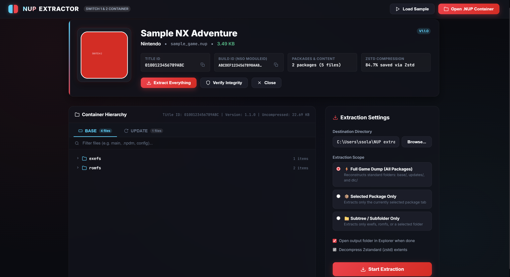
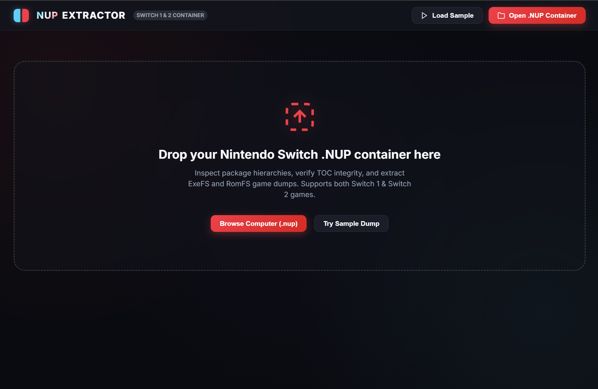
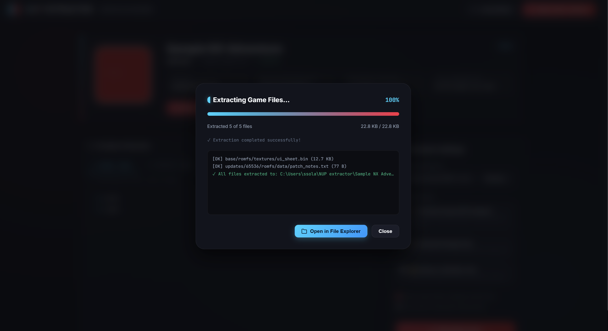

# NUP Extractor

<p align="center">
  
</p>

<p align="center">
  <strong>A high-performance native desktop tool for inspecting, browsing, verifying, and extracting Nintendo Switch 1 & 2 clean-room <code>.nup</code> container archives.</strong>
</p>

<p align="center">
  🌐 <strong>Official Showcase &amp; Live Web Page:</strong> <a href="https://spin0zai.github.io/nup-extractor/"><strong>spin0zai.github.io/nup-extractor</strong></a>
</p>

<p align="center">
  <a href="https://spin0zai.github.io/nup-extractor/"></a>
</p>

<p align="center">
  <a href="https://github.com/SPIN0ZAi/nup-extractor/releases/latest"></a>
  <a href="LICENSE"></a>
  <a href="https://dotnet.microsoft.com"></a>
  <a href="#"></a>
  <a href="#"></a>
</p>

---

## 📸 Screenshots

<p align="center">
  
  <br>
  <em>Container Workspace — Embedded game artwork, metadata, Title/Build IDs, multi-package tabs, interactive file tree, and extraction controls.</em>
</p>

<br>

<p align="center">
  
  &nbsp;&nbsp;
  
</p>
<p align="center">
  <em>Left: Initial welcome dropzone screen &bull; Right: High-speed extraction modal with live progress & activity log.</em>
</p>

---

## ⚡ Overview

**NUP Extractor** is a standalone 64-bit desktop GUI utility built to handle **NX Package (`.nup`)** containers—a modern clean-room specification designed by [a55uka](https://github.com/a55uka/nup) for archiving unencrypted Nintendo Switch (1 and 2) game dumps.

Rather than relying on console scripts or heavy web runtimes, NUP Extractor ships as **pure native applications on both platforms** (no Wine): a `WinExe` WPF + WebView2 shell on Windows and a Photino + WebKitGTK shell on Linux x64, both driving the same platform-neutral engine and IPC contract:
- **Zero Command Prompt Window**: Launches directly into a sleek, hardware-accelerated desktop window.
- **Zero UI Freezing ("Not Responding")**: Employs 64-bit memory-mapped file I/O (`MemoryMappedFile`) and asynchronous background workers (`Task.Run`), ensuring the UI stays completely fluid at 60+ FPS even when extracting 30GB game dumps.
- **SIMD-Accelerated Streaming Decompression**: High-throughput Zstandard (`ZstdSharp`) pipeline with 128KB buffered writes.
- **In-Memory IPC (No Localhost / Sockets)**: Zero network ports, zero socket binding, and no Windows Firewall alerts.

---

## ✨ Features

- **🎨 Modern Switch Glassmorphic UI**: High-contrast obsidian theme with iconic Nintendo Joy-Con neon red and cyan accents, collapsible folder tree, and animated progress gauges.
- **🖼️ Rich Embedded Metadata**: Displays game icons (PNG/JPEG), Title Name, Publisher, Display Version, Title ID, and Build ID (NSO ModuleId) with 1-click clipboard copy buttons.
- **📦 Multi-Package Support**: Inspects all packages bundled inside the container:
  - **Base Game** (`base/`)
  - **Updates & Patches** (`updates/<version>/`)
  - **DLC & Add-ons** (`dlc/<title_id>/<index>/`)
- **📂 Interactive File Explorer**:
  - Live directory tree navigation with file counters and size badges.
  - Per-file compression codec badges (**RAW** vs **Zstd**) and compression ratio stats.
  - Sub-millisecond instant search across thousands of files.
- **⚡ Flexible Extraction Engine**:
  - **Full Game Dump**: Reconstructs the complete game directory hierarchy.
  - **Package Mode**: Extracts only the selected package tab.
  - **Subtree Mode**: Extracts specific folders (e.g. only `romfs/` or `exefs/`).
  - Native OS folder pickers (Windows Explorer dialogs / GTK dialogs on Linux) with auto-open upon completion.
- **🛡️ Integrity Verification**:
  - Validates Superblock structure and Table of Contents (TOC) SHA-256 hash.
  - Deep-verifies individual SHA-256 checksums across every file extent.
- **🔄 In-Place Auto-Updater**:
  - Automatic background checks on startup or on-demand via the **Updates** button.
  - User controls: **Update Now**, **Remind Me Later**, or **Skip This Version**.
  - High-speed streaming download with live MB/s progress telemetry.
  - Seamless in-place replacement and automatic restart without leaving behind temporary files or modifying install directories.
  - On Linux builds, startup checks, release notes and version badges work identically; the in-place apply step is Windows-only, so grab the newest Linux binary from the Releases page.

---

## 🚀 Download & Installation

### Option 1: Direct Download (Recommended)
Download the latest pre-compiled standalone executable from the [Releases](https://github.com) page:

1. Download **`NUP_Extractor-v1.0.0-windows-x64.zip`**.
2. Extract the ZIP anywhere (e.g. Desktop).
3. Double-click **`NUP_Extractor.exe`** to run.

### Linux x64 (native, no Wine)

1. Download the **`NUP_Extractor-linux-x64`** single-file binary from the [Releases](https://github.com/SPIN0ZAi/nup-extractor/releases/latest) page (or build it yourself with `./build_linux.sh`).
2. `chmod +x NUP_Extractor` and run it — the .NET runtime is embedded; the only system requirement is WebKitGTK 4.1 + GTK 3 (preinstalled on most desktop distros):

```bash
# Debian/Ubuntu
sudo apt install libwebkit2gtk-4.1-0
# Fedora/openSUSE
sudo dnf install webkit2gtk4.1 gtk3
```

*(No .NET SDK or Python installation required—everything is self-contained!)*

---

## 🛠️ Building from Source

### Prerequisites
- Windows 10 / 11 (64-bit) **or** Linux x64 (with WebKitGTK 4.1 + GTK 3)
- [.NET 10 SDK](https://dotnet.microsoft.com/download)

### 1. Clone the Repository
```powershell
git clone https://github.com/<your-username>/nup-extractor.git
cd nup-extractor
```

### 2. Run Automated Tests
```powershell
dotnet test NupExtractor.slnx
```

### 3. Build & Publish Standalone Executable
You can run the one-click build script:
```powershell
.\build_native.bat
```

Or run the .NET CLI command:
```powershell
dotnet publish src_native/NupExtractorApp.csproj `
  -c Release `
  -r win-x64 `
  --self-contained `
  -p:PublishSingleFile=true `
  -p:IncludeNativeLibrariesForSelfExtract=true `
  -p:EnableCompressionInSingleFile=true `
  -o dist_native
```

The resulting `NUP_Extractor.exe` will be generated in `dist_native/` (or the project root).

### Building on Linux x64

The same pipeline, natively — no Wine involved:
```bash
dotnet test NupExtractor.slnx     # all 23 tests run on Linux
./build_linux.sh                  # tests + self-contained single-file publish → ./NUP_Extractor
```

Or run the .NET CLI command directly:
```bash
dotnet publish src_linux/NupExtractorLinux.csproj \
  -c Release \
  -r linux-x64 \
  --self-contained \
  -p:PublishSingleFile=true \
  -p:IncludeNativeLibrariesForSelfExtract=true \
  -p:EnableCompressionInSingleFile=true \
  -o dist_linux
```

The resulting `./NUP_Extractor` is a standalone ELF64 binary with the .NET runtime embedded. The WPF project (`src_native`) still cross-compiles on Linux (`EnableWindowsTargeting`) so solution-wide CI works on either OS, but it only *runs* on Windows.

---

## 🧪 Automated Test Suite

The solution includes an extensive **xUnit** automated regression test suite (`tests_native/`):

| Test Case | Scope |
| :--- | :--- |
| `Test_Superblock_Parsing_ValidContainer` | Verifies Superblock fields, versioning, and file size alignment |
| `Test_Superblock_Validation_RejectsBadMagic` | Enforces fail-closed validation on invalid/corrupted magic bytes |
| `Test_TOC_Parsing_PackagesAndNodes` | Validates package table, directory indices, and file nodes |
| `Test_Metadata_Extraction` | Verifies Title Name, Publisher, Version, Build ID, and Icon extraction |
| `Test_Inspect_ReturnsCompleteContract` | Validates full DTO contract structure for frontend consumption |
| `Test_Tree_Children_Resolution` | Tests lazy-loaded folder hierarchy traversal |
| `Test_File_Search` | Validates sub-millisecond file search engine |
| `Test_Decompression_RawAndZstd` | Verifies SHA-256 checksum matches on RAW and Zstd decompressed extents |
| `Test_Full_Extraction_AllPackages` | End-to-end multi-package extraction and directory reconstruction |
| `Test_Package_Mode_Extraction` | Validates isolated single package extraction |
| `Test_Subtree_Mode_Extraction` | Validates subtree directory extraction |
| `Test_Integrity_Verification` | Validates Fast TOC and Deep SHA-256 verification modes |
| `Test_Serialization_Contract_ProducesCamelCase` | Enforces camelCase JSON contract between C# backend and UI |
| `Test_Extraction_ThrowsOnEmptyPath` | Validates defensive argument checking |
| `Test_GetDirChildren_OutOfBoundsThrows` | Validates boundary verification on directory indices |
| `Test_ShellIntegration_RoundTripsThroughRouter` | Drives get/toggle shell-integration actions through the shared IPC router |

---

## 👥 Engineering & Contributing

To maintain high engineering standards, all development follows a Kanban board and Git Flow:
- **Git Flow Guide**: See [docs/WORKFLOW.md](docs/WORKFLOW.md) for branch naming, PR checklist, and release cycles.
- **Kanban Board**: Tasks and bugs are tracked via [GitHub Projects](https://github.com/SPIN0ZAi/nup-extractor/projects).
- **Automated CI**: Pull Requests targeting the `develop` branch are automatically built, packaged, and verified across all 23 unit tests before merging.

---

## 🏛️ Architecture

```
nup-extractor/
├── src_core/                      # Platform-neutral .NET 10 library (runs on Windows & Linux)
│   ├── NupFormat.cs               # Binary layout, records, and constants
│   ├── NupReader.cs               # 64-bit MemoryMappedFile reader & stream decompressor
│   ├── NupEngine.cs               # Core extraction, search, inspection, and verification engine
│   ├── AppUpdateManager.cs        # GitHub Releases update manager
│   ├── IPlatformShell.cs          # OS shell services contract (pickers, messaging, integration)
│   ├── IpcRouter.cs               # Shared in-process IPC message dispatcher
│   └── StartupState.cs            # Launch arguments shared with the router
├── src_native/                    # Windows desktop shell (WPF + WebView2, WinExe)
│   ├── MainWindow.xaml            # Native WPF Window hosting WebView2
│   └── MainWindow.xaml.cs         # WebView2 shell adapter for IPlatformShell
├── src_linux/                     # Linux desktop shell (Photino + WebKitGTK, native ELF)
│   ├── Program.cs                 # CLI contract (--extract-here, --extract-to-folder, ...)
│   ├── PhotinoShell.cs            # WebKitGTK shell adapter for IPlatformShell
│   └── ChromeShim.cs              # window.chrome.webview bridge for WebKit
├── tests_native/                  # xUnit automated test suite (23 tests, runs on both OSes)
│   └── NupTests.cs                # Test specifications & test cases
├── static/                        # Embedded UI Assets (HTML5, CSS3, JS) — served by both shells
│   ├── index.html                 # Joy-Con themed responsive UI layout
│   ├── styles.css                 # Glassmorphic dark styling & animations
│   └── app.js                     # IPC event handling & reactive UI controller
├── pictures/                      # Screenshots showcase
│   ├── main-UI.png                # Dropzone welcome screen
│   ├── extractor-main-UI.png      # Workspace with loaded game container
│   └── extractor-progress-UI.png  # Live extraction modal with progress log
├── docs/                          # Format specifications
│   └── SPEC.md                    # Official NUP container format specification
├── .github/workflows/             # GitHub Actions CI/CD
│   └── build-and-release.yml      # Automated testing, building, and GitHub release pipeline
├── release/                       # Pre-packaged release bundles
│   ├── NUP_Extractor-v1.0.0-windows-x64.zip
│   └── SHA256SUMS.txt
├── build_native.bat               # 1-Click CI Build & Test script (Windows)
├── build_linux.sh                 # 1-Click CI Build & Test script (Linux x64)
├── NupExtractor.slnx              # Modern .NET solution file
├── LICENSE                        # MIT License
└── README.md                      # Project documentation
```

---

## 🐧 Linux Port — Known Limitations

- **Auto-update apply is Windows-only.** The in-place `.exe` swap + relaunch mechanism has no Linux equivalent; `start_update` reports a clear error and users download new releases manually. Update *checking* works on both platforms.
- **Desktop integration is best-effort.** The Windows Explorer context menu (HKCU ProgId) is replaced by a freedesktop `.desktop` entry + `xdg-mime` default on Linux. How "Extract Here" surfaces depends on the file manager (Dolphin/Nautilus render `.desktop` actions differently).
- **Rendering engine differs by shell:** WebView2 (Chromium) on Windows vs WebKitGTK on Linux. The UI is identical HTML/CSS/JS, but WebKit may render subtle CSS/animation differences.
- **System WebKitGTK required** on Linux (the .NET runtime itself is embedded in the single-file binary).
- `grim` is installed for Wayland screenshots but KWin (Plasma) does not expose `wlr-screencopy`; use `spectacle -b -n -o shot.png` on this compositor. `ydotool` requires the `input` group + `ydotoold` daemon (root) to synthesize clicks.

---

## 📄 License & Legal Notice

- **Software License**: Distributed under the [MIT License](LICENSE).
- **Format Specification**: NUP format specification by [a55uka](https://github.com/a55uka/nup) (MIT License).
- **Disclaimer**: This is a clean-room interoperability archive extraction tool. It does **not** contain cryptographic keys (`prod.keys`), proprietary Nintendo code, or copyrighted game files. All game dumps must be legally acquired and unencrypted before use.
